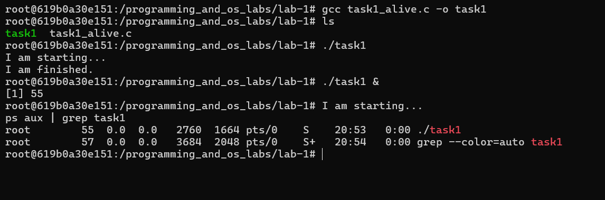
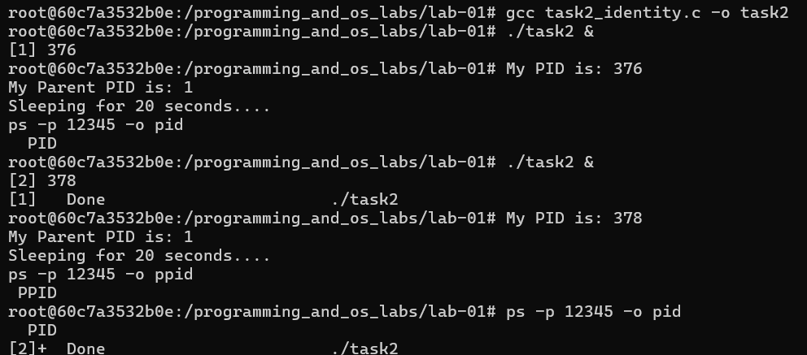
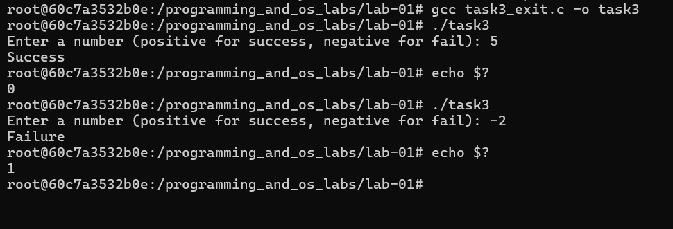
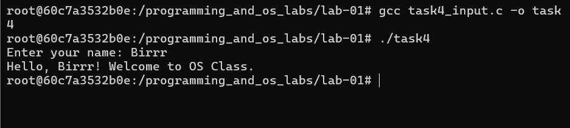

# Lab 3: Investigating Process Lifecycles and OS Interaction

## Introduction

This lab investigates how C programs interact with the Linux operating system and how the operating system manages processes.

The lab focuses on process execution, process identity, process monitoring, exit status, standard input/output, and conditional process termination.

---


## System Environment

| Item | Details |
|---|---|
| Operating System | Ubuntu Linux |
| Environment | Ubuntu running inside Docker |
| Programming Language | C |
| Compiler | GCC |
| Process Tools | `ps` |
| Shell | Linux shell |
| Version Control | Git / GitHub |

---

# Process Lifecycle Overview

A process is a program that is currently being executed by the operating system.

A simplified process lifecycle used in this lab is:

```text
             Program starts
                  |
                  v
             New Process
                  |
                  v
               Running
              /       \
             /         \
            v           v
      Sleeping       Executing
            \           /
             \         /
              v       v
              Running
                  |
                  v
             Process exits
                  |
                  v
              Exit Code
             /         \
            /           \
           v             v
       Success         Failure
        Code 0         Non-zero
```

The Linux operating system manages these processes and provides information and services through system calls and shell interfaces.

---

# Task 1: The Long-Running Process

## Objective

The purpose of Task 1 is to create a process that remains active for approximately 30 seconds and then monitor it while it is running.

The program uses `sleep(1)` inside a loop to pause execution for one second during each iteration.

## Source Code

### `task1_alive.c`

```c
#include <stdio.h>
#include <unistd.h>

int main() {

    printf("I am starting...\n");

    // Loop for 30 seconds
    for(int i = 1; i <= 30; i++) {
        sleep(1);
    }

    printf("I am finished.\n");

    return 0;
}
```

## Compilation

The program was compiled using:

```bash
gcc task1_alive.c -o task1
```

## Normal Execution

```bash
./task1
```

The output was:

```text
I am starting...
I am finished.
```

The program remained active for approximately 30 seconds before displaying the final message.

## Background Execution

The program was then executed in the background:

```bash
./task1 &
```

The shell assigned the background process a job number and PID:

```text
[1] 55
```

The process was then monitored using:

```bash
ps aux | grep task1
```

The process appeared in the process list:

```text
root       55  0.0  0.0  2760  1664 pts/0  S  20:53  0:00 ./task1
root       57  0.0  0.0  3684  2048 pts/0  S+ 20:54  0:00 grep --color=auto task1
```

The important entry is:

```text
./task1
```

with PID:

```text
55
```

This confirms that the program was running as an active Linux process and could be observed using the `ps` command.

## Result

Task 1 successfully demonstrated:

- Compiling a C program with GCC.
- Running a program normally.
- Running a process in the background using `&`.
- Monitoring an active process using `ps aux`.
- Observing the process ID assigned by Linux.

### Screenshot Evidence




---

# Task 2: Process Identity (PID and PPID)

## Objective

Task 2 demonstrates how a process can obtain information about itself and its parent process.

Linux assigns every process a unique Process ID (PID). A process also has a Parent Process ID (PPID), which identifies the process that created it.

- `getpid()` to obtain its own PID.
- `getppid()` to obtain its parent PID.

## Source Code

### `task2_identity.c`

```c
#include <stdio.h>
#include <unistd.h>

int main() {

    // Get current Process ID
    pid_t my_pid = getpid();

    // Get Parent Process ID
    pid_t my_ppid = getppid();

    printf("My PID is: %d\n", my_pid);
    printf("My Parent PID is: %d\n", my_ppid);

    printf("Sleeping for 20 seconds...\n");

    sleep(20);

    return 0;
}
```

## Compilation

```bash
gcc task2_identity.c -o task2
```

## Execution

The program was executed in the background:

```bash
./task2 &
```

The first execution :

```text
My PID is: 376
My Parent PID is: 1
Sleeping for 20 seconds....
```

second execution:

```text
My PID is: 378
My Parent PID is: 1
Sleeping for 20 seconds....
```

The observed PID values were therefore:

| Execution | PID | PPID |
|---|---:|---:|
| First | 376 | 1 |
| Second | 378 | 1 |

The PPID was `1` in the Docker environment used for this lab.

## Verification

The lab instructions use `ps` to verify the process identity.

command is:

```bash
ps -p <PID> -o pid,ppid,cmd
```

For example, for the observed PID `376`:

```bash
ps -p 376 -o pid,ppid,cmd
```

The process was designed to sleep for 20 seconds, providing time for its identity to be inspected.

## Result

Task 2 successfully demonstrated:

- Obtaining the current process ID using `getpid()`.
- Obtaining the parent process ID using `getppid()`.
- Running the process in the background.
- Using Linux process information to identify a running process.

### Screenshot Evidence



---

# Task 3: Exit Codes and OS Feedback

## Objective

Task 3 demonstrates how a C program communicates its success or failure to the operating system through its exit status.

The program returns:

- `0` when the operation is successful.
- `1` when the operation fails.

The shell stores the exit status of the most recently executed command in the special variable:

```bash
$?
```

## Source Code

### `task3_exit.c`

```c
#include <stdio.h>

int main() {

    int num;

    printf("Enter a number (positive for success, negative for fail): ");
    scanf("%d", &num);

    if (num > 0) {
        printf("Success\n");
        return 0;
    } else {
        printf("Failure\n");
        return 1;
    }
}
```

## Compilation

```bash
gcc task3_exit.c -o task3
```

## Scenario A: Positive Input

The program was executed:

```bash
./task3
```

Input:

```text
5
```

Output:

```text
Success
```

The exit status was then checked:

```bash
echo $?
```

Output:

```text
0
```

Therefore:

```text
Positive input
      |
      v
  Success
      |
      v
 return 0
      |
      v
Exit status = 0
```

## Scenario B: Negative Input

The program was executed again:

```bash
./task3
```

Input:

```text
-2
```

Output:

```text
Failure
```

The exit status was checked:

```bash
echo $?
```

Output:

```text
1
```

Therefore:

```text
Negative input
      |
      v
   Failure
      |
      v
  return 1
      |
      v
Exit status = 1
```

## Result

Task 3 successfully demonstrated how a C program communicates its final status to the operating system and how the Linux shell can retrieve that status using `$?`.

| Input | Program Output | Exit Status |
|---|---|---:|
| `5` | Success | `0` |
| `-2` | Failure | `1` |

### Screenshot Evidence



---

# Task 4: Standard I/O Streams

## Objective

Task 4 demonstrates the use of standard input and standard output in a C program.

The program uses:

- `scanf()` to receive input from standard input (`stdin`).
- `printf()` to display output through standard output (`stdout`).

## Source Code

### `task4_input.c`

```c
#include <stdio.h>

int main() {

    char name[50];

    printf("Enter your name: ");

    // Read string from standard input
    scanf("%s", name);

    printf("Hello, %s! Welcome to OS Class.\n", name);

    return 0;
}
```

## Compilation

```bash
gcc task4_input.c -o task4
```

## Execution

The program was executed using:

```bash
./task4
```

The input provided was:

```text
Birrr
```

The program produced:

```text
Enter your name: Birrr
Hello, Birrr! Welcome to OS Class.
```

## Result

Task 4 successfully demonstrated:

- Reading user input using `scanf()`.
- Using standard input (`stdin`).
- Displaying output using `printf()`.
- Using standard output (`stdout`).
- Passing user input into a formatted output message.

### Screenshot Evidence



---

# Task 5: Conditional Execution and Termination

## Objective

Task 5 demonstrates conditional process execution and termination based on user input.

The program:

1. Displays its current PID.
2. Asks the user whether to continue.
3. If the user enters `1`, the program continues and returns `0`.
4. Otherwise, it exits and returns `1`.

## Source Code

### `task5_control.c`

```c
#include <stdio.h>
#include <unistd.h>

int main() {

    int choice;

    // Print PID at start
    printf("Current PID: %d\n", getpid());

    printf("Do you want to continue? (1 for Yes, 0 for No): ");
    scanf("%d", &choice);

    if (choice == 1) {

        printf("Continuing...\n");
        sleep(5);

        return 0;

    } else {

        printf("Exiting...\n");

        return 1;
    }
}
```

## Compilation

```bash
gcc task5_control.c -o task5
```

## Scenario A: Continue

The program was executed:

```bash
./task5
```

The observed PID was:

```text
Current PID: 407
```

Input:

```text
1
```

Output:

```text
Continuing...
```

The exit status was checked:

```bash
echo $?
```

Output:

```text
0
```

The execution flow was:

```text
Input: 1
   |
   v
Continuing...
   |
   v
return 0
   |
   v
Exit status = 0
```

## Scenario B: Exit

The program was executed again:

```bash
./task5
```

The observed PID was:

```text
Current PID: 408
```

Input:

```text
0
```

Output:

```text
Exiting...
```

The exit status was checked:

```bash
echo $?
```

Output:

```text
1
```

The execution flow was:

```text
Input: 0
   |
   v
Exiting...
   |
   v
return 1
   |
   v
Exit status = 1
```

## Result

Task 5 successfully demonstrated:

- Obtaining a process PID using `getpid()`.
- Making a decision based on user input.
- Continuing execution conditionally.
- Terminating with different exit codes.
- Checking the exit code using `$?`.

| Input | PID | Output | Exit Status |
|---|---:|---|---:|
| `1` | 407 | Continuing... | `0` |
| `0` | 408 | Exiting... | `1` |

### Screenshot Evidence


---

# Overall Process and OS Interaction

The five tasks demonstrate different ways a C program interacts with the Linux operating system.

```text
                  C Program
                      |
          +-----------+-----------+
          |           |           |
          v           v           v
      Process       Input       Exit Code
      Identity        |             |
          |           |             |
     +----+----+      |        +----+----+
     |         |      |        |         |
     v         v      v        v         v
   getpid() getppid() scanf() return 0  return 1
     |         |      |        |         |
     +---------+------+--------+---------+
                      |
                      v
                Linux Operating
                    System
```

---


# Summary of Tasks

| Task | Main Concept | Functions / Commands |
|---|---|---|
| Task 1 | Long-running process | `sleep()`, `&`, `ps` |
| Task 2 | Process identity | `getpid()`, `getppid()`, `ps` |
| Task 3 | Exit codes | `return`, `echo $?` |
| Task 4 | Standard I/O | `scanf()`, `printf()` |
| Task 5 | Conditional termination | `getpid()`, `sleep()`, `return`, `echo $?` |

---


# Conclusion

This lab demonstrated the relationship between C programs and the Linux operating system.

The experiments showed that a running C program is treated as a process by the operating system. Process information can be obtained using functions such as `getpid()` and `getppid()`, while process execution can be controlled using functions such as `sleep()`.

The lab also demonstrated how programs communicate their final result to the shell using exit codes and how standard input and output allow interaction between the user and a running process.

Overall, the practical exercises connected high-level C programming with fundamental Linux process-management concepts.

---
