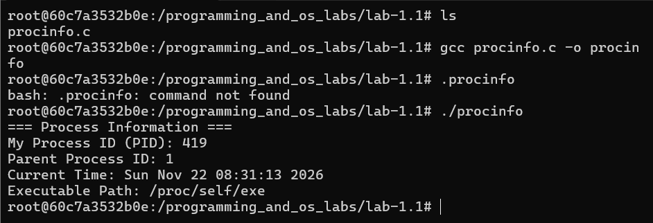
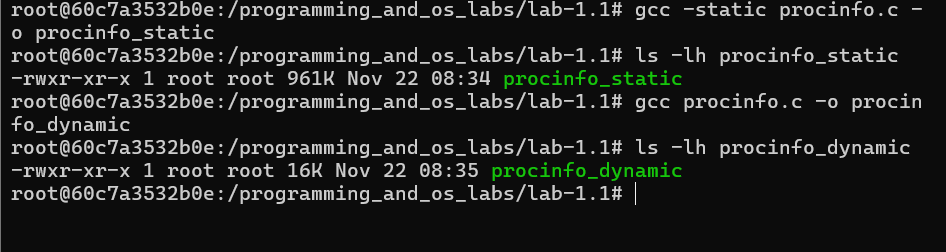
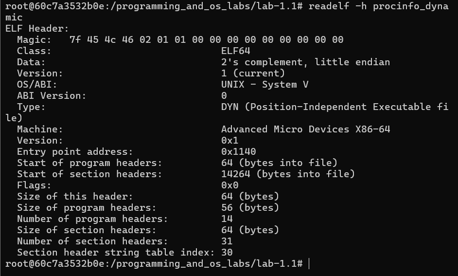
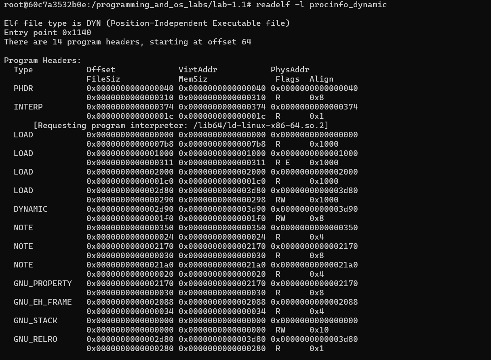
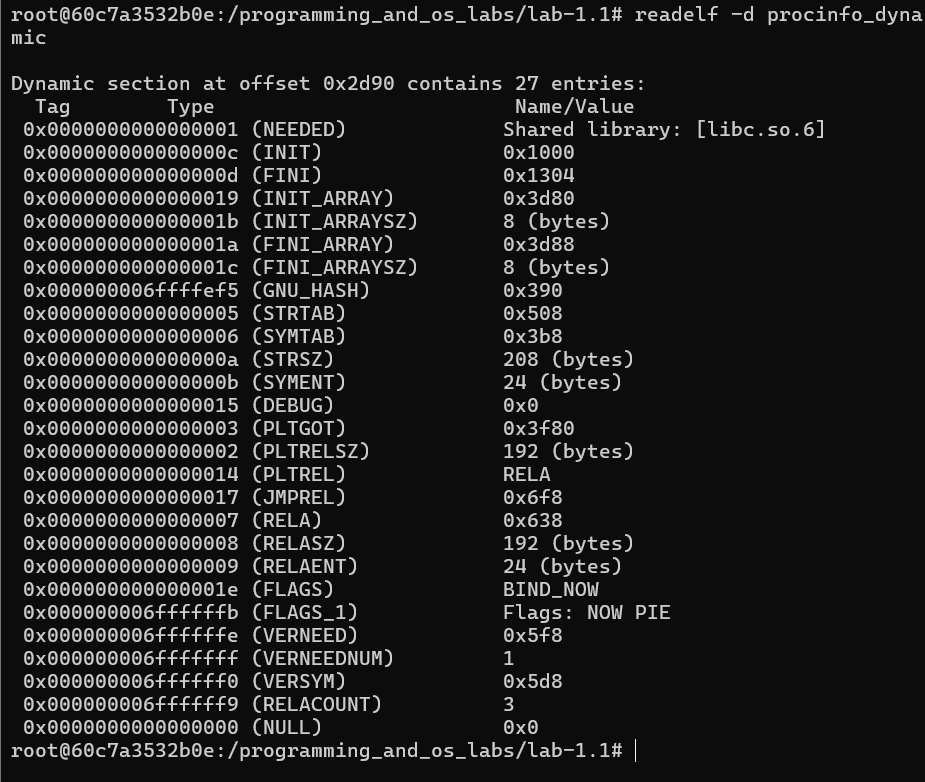
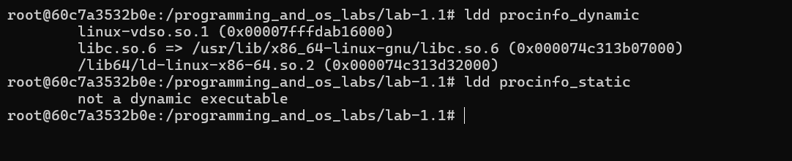

# Lab 2: C Libraries, Linking, and ELF Executable Structure

## Introduction

This lab explores how C programs use libraries, how static and dynamic linking work, and how Linux ELF executables can be inspected using `readelf` and `ldd`.

---

## 1. Process Information Program

### `procinfo.c`

The program displays:

- Process ID (PID)
- Parent Process ID (PPID)
- Current time
- Executable path

Compile:

```bash
gcc procinfo.c -o procinfo
```

Run:

```bash
./procinfo
```

### Actual Output

```text
=== Process Information ===
My Process ID (PID): 419
Parent Process ID: 1
Current Time: Sun Nov 22 08:31:13 2026
Executable Path: /proc/self/exe
```

The program successfully retrieved information about the running process.

---

## 2. C Libraries

C programs use header files and libraries.

### Header Files

Header files contain declarations and function prototypes used by the compiler.

Examples:

```text
/usr/include/stdio.h
/usr/include/unistd.h
/usr/include/time.h
```

### Libraries

Linux commonly uses:

- `.a` for static libraries
- `.so` for shared libraries

The C Standard Library includes:

```text
libc.so.6
```

---

## 3. Static Linking

A static executable contains the required library code inside the executable.

Compile:

```bash
gcc -static procinfo.c -o procinfo_static
```

Check size:

```bash
ls -lh procinfo_static
```

### Result

```text
-rwxr-xr-x 1 root root 961K ... procinfo_static
```

The static executable was approximately **961 KB**.

---

## 4. Dynamic Linking

A dynamically linked executable uses shared libraries at runtime.

Compile:

```bash
gcc procinfo.c -o procinfo_dynamic
```

Check size:

```bash
ls -lh procinfo_dynamic
```

### Result

```text
-rwxr-xr-x 1 root root 16K ... procinfo_dynamic
```

The dynamically linked executable was approximately **16 KB**.

### Comparison

| Type | Size | Library Code |
|---|---:|---|
| Static | 961K | Included in executable |
| Dynamic | 16K | Loaded from shared libraries |

---

## 5. ELF Header

Linux executables use the **ELF (Executable and Linkable Format)**.

Inspect the ELF header:

```bash
readelf -h procinfo_dynamic
```

Important results:

```text
Class:        ELF64
Type:         DYN
Machine:      Advanced Micro Devices X86-64
```

This confirms that the executable is a 64-bit ELF executable for the x86-64 architecture.

---

## 6. Program Headers

Inspect program headers:

```bash
readelf -l procinfo_dynamic
```

Important entries included:

```text
INTERP
LOAD
DYNAMIC
GNU_STACK
GNU_RELRO
```

The `INTERP` entry showed the dynamic linker:

```text
/lib64/ld-linux-x86-64.so.2
```

---

## 7. Dynamic Section

Inspect the dynamic section:

```bash
readelf -d procinfo_dynamic
```

The important dependency was:

```text
(NEEDED) Shared library: [libc.so.6]
```

This shows that the dynamically linked executable requires the shared C library.

---

## 8. Shared Library Dependencies

Use `ldd` to display shared-library dependencies:

```bash
ldd procinfo_dynamic
```

The output showed:

```text
libc.so.6 => /usr/lib/x86_64-linux-gnu/libc.so.6
```

It also showed:

```text
/lib64/ld-linux-x86-64.so.2
```

For the statically linked executable:

```bash
ldd procinfo_static
```

Result:

```text
not a dynamic executable
```

---

## 9. Key Concepts

```text
C Source Code
      |
      v
    GCC
      |
      v
   Linking
   /     \
Static   Dynamic
  |         |
  v         v
Large     Small
Binary    Binary
            |
            v
       Shared Libraries
```

### Static Linking

Library code is included in the executable.

### Dynamic Linking

The executable uses shared libraries loaded at runtime.

### ELF

ELF is the executable format used by Linux for compiled programs.

### `readelf`

Used to inspect ELF headers, program headers, and dynamic information.

### `ldd`

Used to display shared-library dependencies.

---

## 10. Screenshots


1. 
2. 
3. 
4. 
5. 
6. 

---

## Conclusion

This lab demonstrated how C programs use libraries and how executables are created and linked.

The main differences between static and dynamic linking were observed through executable size and library dependencies. The `readelf` commands were used to examine the ELF structure, while `ldd` showed the shared libraries required by the dynamic executable.

The practical results showed:

- Static executable: **961K**
- Dynamic executable: **16K**
- Dynamic dependency: **libc.so.6**
- ELF format: **ELF64**
- Architecture: **x86-64**

---
